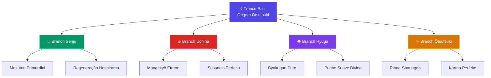
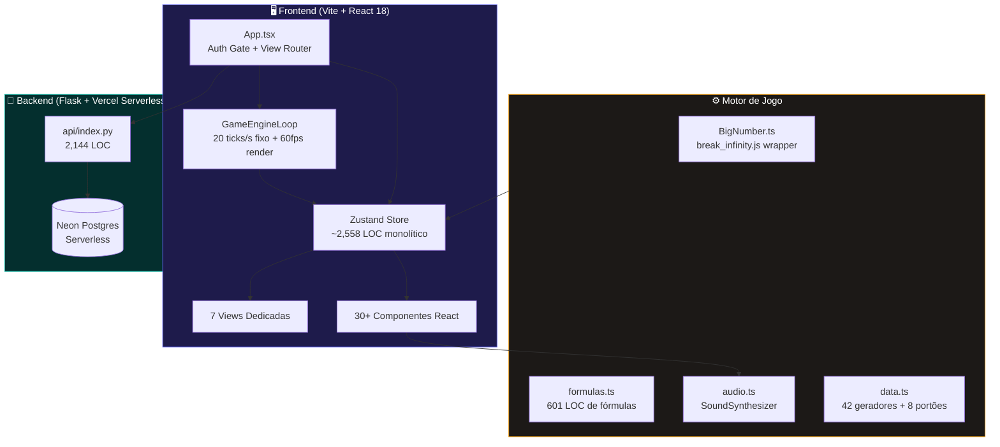
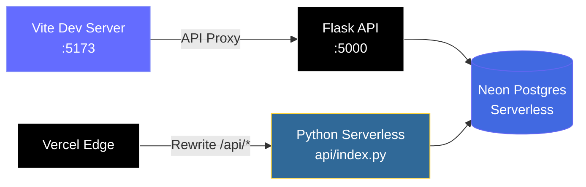

<div align="center">

<!-- HERO BANNER -->


<br/>

**Recrute o exército ninja definitivo, desbloqueie os Oito Portões Internos e ascenda ao patamar de Deus Ōtsutsuki — um clique de cada vez.**

<br/>

<!-- TECH BADGES -->
[](https://react.dev/)
[](https://www.typescriptlang.org/)
[](https://vitejs.dev/)
[](https://zustand-demo.pmnd.rs/)
[](https://tailwindcss.com/)
[](https://flask.palletsprojects.com/)
[](https://neon.tech/)
[](https://vercel.com/)

<br/>

<!-- STATUS BADGES -->


</div>

---

## 📑 Sumário

<details>
<summary><strong>Clique para expandir a navegação completa</strong></summary>

- [Visão Geral & Enredo](#-visão-geral--enredo)
- [Mapa de Controles](#-mapa-de-controles)
- [Sistemas de Jogo](#-sistemas-de-jogo)
  - [Economia & Geradores](#-economia--geradores-42-tropas)
  - [Técnicas & Upgrades](#-técnicas--upgrades-75-técnicas)
  - [Oito Portões Internos](#-oito-portões-internos-hachimon-tonkō)
  - [Árvore de Clãs (Prestígio)](#-árvore-genealógica-de-clãs-prestígio)
  - [Gauntlet Roguelike](#️-gauntlet-roguelike--arena-de-desafios)
  - [Missões Shinobi](#-missões-shinobi-ranks-e-a-ss)
  - [Pavilhão Gacha & Forja](#-pavilhão-gacha--forja-lendária)
  - [Inventário RPG](#-inventário-rpg--afinidade-elemental)
  - [Patentes & Promoções](#-patentes--promoções-shinobi)
  - [Rankings & Leaderboards](#-rankings--leaderboards)
  - [Perfil Shinobi Customizável](#-perfil-shinobi-customizável)
  - [Recompensas de Presença](#-recompensas-de-presença-online)
  - [Chat da Aldeia](#-chat-shinobi-da-aldeia)
  - [Motor de Áudio](#-motor-de-áudio-procedural)
  - [Salvamento & Persistência](#-salvamento--persistência)
- [Arquitetura Técnica](#️-arquitetura-técnica)
- [Como Executar Localmente](#-como-executar-localmente)
- [Stack Técnica Detalhada](#-stack-técnica-detalhada)
- [Números do Projeto](#-números-do-projeto)
- [Créditos & Atribuições](#-créditos--atribuição-de-assets)

</details>

---

## 🌀 Visão Geral & Enredo

> **Chakra Clicker** é um **idle/clicker game incremental** ambientado no universo ninja de Naruto, construído como uma Single Page Application reativa com arquitetura desacoplada de game loop determinístico.

Você assume o papel de um jovem aspirante da **Academia Ninja de Konoha**. Seu objetivo é acumular **chakra** através de cliques manuais e geradores automáticos (tropas), investir em **técnicas**, subir de **patente shinobi**, enfrentar **chefes lendários** em um gauntlet roguelike, forjar **armas raras** e, eventualmente, **renascer** (prestígio) para desbloquear a **Árvore Genealógica de Clãs** — uma progressão meta que transcende ciclos de jogo.

```
📈 Progressão de Escala
━━━━━━━━━━━━━━━━━━━━━━━━━━━━━━━━━━━━━━━━━━━━━━━━━━━━━━━━━━━━━━

  Estudante da Academia ──→ Shibai Ōtsutsuki
  0.5 chakra/s            10^30 chakra/s

  Suportado pela biblioteca break_infinity.js
  para aritmética de números até ~10^308
```

---

## 🎮 Mapa de Controles

| Entrada | Ação |
|:---:|:---|
| 🖱️ **Clique Esquerdo** no Palco Central | Gerar chakra manual (floating numbers + shockwaves cinéticas) |
| 📱 **Toque / Tap** (Mobile) | Mesmo efeito — interface touch-friendly |
| ⎋ **ESC** | Retornar à visão principal do Cockpit Shinobi |
| 🧭 **Botões da Navbar** | Navegar entre módulos: Desafios, Missões, Inventário, Rankings |
| 🔊 / 🔇 **Toggle Áudio** | Ativar/desativar SFX procedural (Web Audio API) |
| **#** **Notação** | Alternar entre sufixos (K, M, B, T…) e científica (1.23e15) |
| ⚡ **Modo Cinético** | Toggle de partículas, tremor e screen shake em crits |
| ◀ ▶ **Painéis Laterais** | Expandir/colapsar sidebars do Cockpit (Economy / Operations) |

---

## 🔥 Sistemas de Jogo

### 🏯 Economia & Geradores (42 Tropas)

<table>
<tr>
<td width="60%">

- **42 tropas** organizadas em **5 tiers** progressivos
- Custo exponencial com inflação geométrica escalonada por segmento de nível
- Compras em modo **×1, ×10, ×25, ×100** ou **MAX**, com suporte a **venda** com reembolso parcial
- **Marcos de Nível** (milestones) nos níveis 25, 50, 100, 200, 300 e 500 com insígnias e bônus escalonados

</td>
<td>

```
PROGRESSÃO DE TIERS
━━━━━━━━━━━━━━━━━━━
🟢 Iniciante
🔵 Elite
🟣 Lendário
🟠 Cósmico
🔴 Divino
━━━━━━━━━━━━━━━━━━━
INFLAÇÃO POR NÍVEL
n ≤ 50  → 1.22×
n ≤ 100 → 1.28×
n > 100 → 1.35×
```

</td>
</tr>
</table>

<details>
<summary>📋 <strong>Exemplos de Tropas por Tier</strong></summary>

| Tier | Tropa | CPS Base | Custo Base |
|:---:|:---|:---:|:---:|
| 🟢 Iniciante | Estudante da Academia | 0.5/s | 98 |
| 🟢 Iniciante | Clone das Sombras | 2.0/s | 650 |
| 🟢 Iniciante | Ninja Gennin | 8.0/s | 3,900 |
| 🔵 Elite | Jōnin de Elite | 150/s | 130K |
| 🔵 Elite | Capitão da ANBU | 600/s | 780K |
| 🟣 Lendário | Sannin Lendário | 2,500/s | 4.55M |
| 🟠 Cósmico | Jinchūriki | *escalável* | *escalável* |
| 🔴 Divino | Shibai Ōtsutsuki | *10^30* | *10^30* |

> Cada tropa possui **lore canônico** e desbloqueio progressivo conforme o chakra acumulado.

</details>

---

### 🔮 Técnicas & Upgrades (75+ Técnicas)

- **Três árvores de habilidade** com cadeias evolutivas v1 → v2 → v3:

| Árvore | Foco | Exemplos |
|:---:|:---|:---|
| 🥊 **Taijutsu** | Poder de clique ativo | Furacão da Folha, Portões Internos |
| 📜 **Fūinjutsu** | Reduções de custo | Selo de Contenção, Selo Dimensional |
| 🌀 **Ninjutsu** | Multiplicadores de CPS | Rasengan, Manto da Kyuubi, Susano'o |

- Upgrades globais: multiplicadores de CPS (×2, ×5, ×8, ×10), conversão CPS→Clique, redução de custo de geradores
- Desbloqueios temáticos incluem: **Tsukuyomi Infinito**, **Fruto da Árvore Divina**, **Rinnegan Supremo**

---

### 🚪 Oito Portões Internos (Hachimon Tonkō)

> Os lendários Oito Portões de Chakra do corpo humano — cada portão remove um limitador biológico e concede poder devastador ao custo de exaustão muscular.

```
┌─────────────────────────────────────────────────────────────┐
│  Portão 1: Abertura    →  Portão 4: Dor       → ...       │
│  Portão 2: Descanso    →  Portão 5: Limite    → ...       │
│  Portão 3: Vida        →  Portão 6: Vista     → ...       │
│                         →  Portão 7: Admiração → 🔴 Morte │
├─────────────────────────────────────────────────────────────┤
│  ⚡ Multiplicador: até 80× CPS durante ativação            │
│  💀 Exaustão: período de cooldown após desativação          │
│  🔒 Custo crescente de chakra para desbloquear cada portão  │
└─────────────────────────────────────────────────────────────┘
```

---

### 🌳 Árvore Genealógica de Clãs (Prestígio)

Sistema de **Renascimento Shinobi** que reseta o progresso em troca de **Chakra Ancestral**, desbloqueando uma árvore permanente de poderes.



| Componente | Detalhe |
|:---|:---|
| **Nós Totais** | 60 nós distribuídos em 5 branches |
| **Branches** | Raiz, Senju, Uchiha, Hyūga, Ōtsutsuki |
| **Bônus** | CPS ×, poder de clique ×, chance crítica %, dano crítico ×, recompensas × |
| **Revelação** | Nós ocultos revelados progressivamente por compra |

---

### ⚔️ Gauntlet Roguelike — Arena de Desafios

> Uma arena de combate com **40+ chefes canônicos** organizados por arcos narrativos, cada um com mecânicas de combate únicas.

<details>
<summary>🗡️ <strong>Mecânicas de Boss Detalhadas</strong></summary>

| Mecânica | Descrição |
|:---|:---|
| 🛡️ **Escudos** | Redução temporária de dano nos primeiros segundos |
| 💚 **Regeneração** | HP restaurado passivamente durante o combate |
| ☠️ **Veneno** | Dreno contínuo de chakra do jogador |
| ⚡ **QTE** | Quick Time Events aleatórios para bônus de dano |
| 🔄 **Fases** | Múltiplas barras de HP com transições de fase |

</details>

```
FÓRMULA DE HP DOS BOSSES (Hardcore DPS Check)
━━━━━━━━━━━━━━━━━━━━━━━━━━━━━━━━━━━━━━━━━━━━
  HP(n) = 500 × 1.48^(n - 1)

FÓRMULA DE RECOMPENSA
━━━━━━━━━━━━━━━━━━━━━
  Recompensa(n) = min(200 × 1.15^(n - 1), CPS_estável × 25)
```

- **Arcos**: Clássico (Prólogo) → Shippuden → Guerra & Ōtsutsuki → Boruto & Pós-Guerra
- **Loot de boss**: drops temáticos com sistema de **10 tiers de raridade** (Básico → Divino → ADM)
- **Auto-avanço** e **auto-loop** para farming automático
- **Sistema RPG de Combate**: nível 1-700 com atributos distribuíveis (Força / Vitalidade / Agilidade)

---

### 📋 Missões Shinobi (Ranks E a SS)

> Quadro oficial de missões com briefing narrativo, escolhas táticas ramificadas e sistema de risco-recompensa.

| Rank | Dificuldade | Tempo | Patente Mínima |
|:---:|:---|:---:|:---|
| 🟢 **E** | Academia | 15s | Estudante |
| 🔵 **D** | Gennin | 30s | Gennin |
| 🟣 **C** | Chūnin | 60s | Chūnin |
| 🟠 **B** | Jōnin | 90s | Tokubetsu Jōnin |
| 🔴 **A** | Elite | 120s | Jōnin |
| ⚫ **S** | Kage | 180s | ANBU |
| 💀 **SS** | Lendário | 300s | Sannin |

- Cada missão apresenta **2+ escolhas táticas** com probabilidades distintas de sucesso
- **Minigames embutidos** (Chakra Pulse, Hand Seals) concedem bônus de taxa de sucesso
- **Recompensas**: chakra, chakra ancestral, bilhetes gacha, fragmentos de forja, buffs temporários
- **Penalidades de falha**: exaustão de clique, drenagem de chakra, cooldown

---

### 🎰 Pavilhão Gacha & Forja Lendária

<table>
<tr>
<td width="50%">

#### 🏯 Templo de Invocação
- Pulls **×1** e **×10** usando bilhetes ganhos em missões e boss fights
- Sistema de **pity** com garantia de raridade
- Pool de **22+ itens** com peso estocástico por tier

</td>
<td>

#### 🔨 Forja Lendária
- **16 receitas** de armas lendárias usando fragmentos
- **Refinamento** de equipamentos para subir nível
- **Desmontagem** de itens para obter fragmentos
- Catálogo visual com requisitos e preview

</td>
</tr>
</table>

---

### 🎒 Inventário RPG & Afinidade Elemental

> Sistema de equipamento estilo MMO com **Paper Doll** visual e mecânicas de afinidade elemental.

```
            ┌─────────────────────┐
            │     PAPER DOLL      │
            │                     │
            │  [Elmo]    [Máscara]│
            │  [Peitoral] [Capa]  │
            │  [Luvas]   [Colar]  │
            │  [Botas]  [Mochila] │
            │                     │
            │ [Arma CC]  [Arma LA]│
            │       [Runa]        │
            └─────────────────────┘
              11 Slots × 10 Raridades
```

**10 Níveis de Raridade:**

| Tier | Cor | Tier | Cor |
|:---|:---:|:---|:---:|
| ⬜ Básico | `#9CA3AF` | 🟣 Épico | `#8B5CF6` |
| ⬛ Comum | `#D1D5DB` | 🟡 Lendário | `#F59E0B` |
| 🟢 Incomum | `#22C55E` | 🔴 Mítico | `#EF4444` |
| 🔵 Raro | `#3B82F6` | 💎 Divino | `#06B6D4` |
| 🟣 Muito Raro | `#A855F7` | 👑 ADM | `#FFD700` |

**5 Afinidades Elementais** com sistema de sacrifício:
`🔥 Katon` · `💨 Fūton` · `⚡ Raiton` · `🪨 Doton` · `🌊 Suiton`

---

### 🏅 Patentes & Promoções Shinobi

> Hierarquia completa com **9 missões de promoção** sequenciais, cada uma com requisitos, examinadores canônicos e recompensas exclusivas.

```
Estudante ─→ Gennin ─→ Chūnin ─→ Tokubetsu Jōnin ─→ Jōnin
                                                        │
    Deus Shinobi ←─ Sábio ←─ Kage ←─ Sannin ←─ ANBU ←─┘
```

Cada promoção requer: cliques mínimos, CPS mínimo, chakra total, bosses derrotados e concede bônus permanentes + itens exclusivos.

---

### 🏆 Rankings & Leaderboards

- **Quadro de Honra Global** sincronizado com Neon Postgres em tempo real
- Rankings por: chakra total, nível de combate, chefes derrotados, patente
- **Rivais Shinobi** com perfis gerados para competição contextual

---

### 👤 Perfil Shinobi Customizável

> Sistema de personalização estilo Discord com cartão de perfil visual.

- **Avatares temáticos** de personagens canônicos (Naruto, Sasuke, Sakura, Kakashi…)
- **Molduras de avatar** desbloqueáveis por patente e progresso
- **Banners customizáveis** com presets temáticos
- **Insígnias decorativas** (16 insígnias) em 4 categorias: Liderança, Combate, Linhagem, Legado
- **Ninja favorito** com citação e clã exibidos no perfil

---

### 🎁 Recompensas de Presença Online

- **Sistema de provisões** com metas de tempo online perpétuas
- Recompensas escalonadas por tier de presença
- Buff temporário de CPS ao resgatar recompensas

### 💬 Chat Shinobi da Aldeia

- Chat integrado com **3 canais** (Geral, Clãs, Anúncios)
- Mensagens ambientais simuladas da comunidade ninja
- Sistema de **reações com emoji** e picker de emojis rápidos

### 🔊 Motor de Áudio Procedural

- **SFX 100% sintetizado via Web Audio API** — zero arquivos de áudio externos
- **8 efeitos sonoros** distintos: clique, crítico, compra, level up, jutsu, sucesso, falha, drop mítico
- Toggle de mute com persistência em `localStorage`
- Inicialização lazy com fallback para `webkitAudioContext`

### 💾 Salvamento & Persistência

| Método | Intervalo | Descrição |
|:---|:---:|:---|
| 🔄 **Auto-save** | 10s | Serialização automática em `localStorage` |
| 🚪 **Save on Exit** | `beforeunload` | Salva ao fechar ou trocar de aba |
| ☁️ **Cloud Save** | Manual/Auth | Sincronizado com **Neon Postgres** (JSONB) |
| 🔑 **Isolamento** | Per-user | Chave de save única por conta autenticada |

---

## 🏗️ Arquitetura Técnica

### Visão Geral da Arquitetura



### Estrutura de Diretórios

```
Chakra/
├── 📦 src/                          # Código-fonte principal (77 arquivos, 27.3k LOC)
│   ├── 🔧 engine/                   # Núcleo do motor de jogo
│   │   ├── GameLoop.ts              # Loop desacoplado: 20 ticks/s (fixo) + 60 FPS render
│   │   ├── BigNumber.ts             # Wrapper break_infinity.js com formatação dinâmica
│   │   ├── formulas.ts              # 601 LOC: custo, CPS, clique, desconto, prestígio
│   │   ├── audio.ts                 # Sintetizador procedural (Web Audio API)
│   │   └── data.ts                  # 42 geradores, upgrades e 8 portões (definições)
│   │
│   ├── 🗃️ store/
│   │   └── useGameStore.ts          # Zustand monolítico (~2,558 LOC) — todo estado do jogo
│   │
│   ├── 🪝 hooks/
│   │   ├── useGameLoop.ts           # Inicializa loop, auto-save e beforeunload
│   │   └── usePlaytime.ts           # Tracker de tempo online e provisões
│   │
│   ├── 📐 types/                    # 15 módulos de tipagem TypeScript
│   │   ├── auth.ts                  # Schemas Zod para autenticação
│   │   ├── combat.ts                # Boss, Gauntlet, RPG stats, loot
│   │   ├── economy.ts               # Geradores e modos de loja
│   │   ├── inventory.ts             # Paper Doll, 11 slots de gear
│   │   ├── missions.ts              # Missões E-SS, escolhas táticas
│   │   ├── prestige.ts              # Árvore de clãs e branches
│   │   ├── rankings.ts              # Patentes e promoções
│   │   ├── rarity.ts                # 10 tiers com pesos estocásticos
│   │   └── ...                      # + 7 módulos adicionais
│   │
│   ├── 📊 constants/                # Dados estáticos e catálogos
│   │   ├── upgrades.ts              # 75+ técnicas com evolução v1/v2/v3
│   │   ├── rankings.ts              # 9 patentes + 9 missões de promoção
│   │   ├── missionsCatalog.ts       # 14+ missões com escolhas ramificadas
│   │   ├── bossLootData.ts          # 41 tabelas de loot temático (108KB)
│   │   ├── clanNodes.ts             # 60 nós da Árvore de Clãs
│   │   ├── gachaPool.ts             # 22+ itens do Pavilhão Gacha
│   │   ├── forgeCatalog.ts          # 16 receitas da Forja Lendária
│   │   ├── insignias.ts             # 16 insígnias decorativas
│   │   ├── profileCustomization.ts  # Avatares, molduras e banners
│   │   └── equipmentCatalog.ts      # 10+ equipamentos base
│   │
│   ├── 📁 data/
│   │   └── gauntletBosses.ts        # 40+ chefes com HP, mecânicas e lore
│   │
│   ├── 🧩 components/
│   │   ├── core/                    # ActionStage, Background animado, Portões
│   │   ├── layout/                  # Navbar, CockpitLayout (3 colunas responsivas)
│   │   ├── economy/                 # EconomyPanel, UpgradeCard, UpgradesList
│   │   ├── challenges/              # OperationsPanel, Battlefield, RankingDashboard
│   │   ├── views/                   # 7 views: Challenges, ClanTree, Missions...
│   │   ├── missions/                # GachaTemple, LegendaryForge, Minigames
│   │   ├── chat/                    # ShinobiChatWidget
│   │   ├── profile/                 # DiscordProfileCard, InsigniaBadge
│   │   ├── auth/                    # LoginPage, AuthModal
│   │   └── common/                  # Modais, Notifiers, Badges
│   │
│   ├── 🔌 services/
│   │   └── firebase.ts              # Configuração Firebase (Realtime DB)
│   │
│   ├── ⚙️ config/
│   │   └── api.ts                   # URL da API (Vercel / Local)
│   │
│   └── App.tsx                      # Roteamento por estado + auth gate
│
├── 🐍 api/
│   └── index.py                     # API REST Flask (2,144 LOC) — Vercel Serverless
│
├── 📜 js/                           # Versão legacy vanilla (15 módulos)
├── 🎨 css/                          # Stylesheet vanilla (1,431 LOC)
├── 📚 docs/                         # Documentação de design (bosses, skills)
├── 🔧 scripts/                      # Scripts utilitários (migração, balanceamento)
├── 📋 Makefile                      # Orquestrador cross-platform (Win/Mac/Linux)
├── 🚀 vercel.json                   # Rewrites para API serverless
└── 📦 package.json                  # Dependências e scripts npm
```

### Padrão do Game Loop

O motor utiliza um **loop fixo-variável desacoplado** ([`GameEngineLoop`](file:///c:/Users/Aluno/Desktop/chakra/Chakra/src/engine/GameLoop.ts)):

```
┌──────────────────────── requestAnimationFrame ──────────────────────────┐
│                                                                         │
│   ┌─────────────────────┐     ┌──────────────────────┐                 │
│   │  TICKS LÓGICOS      │     │  RENDER VISUAL       │                 │
│   │  20/s fixo (50ms)   │     │  60 FPS (variável)   │                 │
│   │  ─ Acúmulo CPS      │     │  ─ React re-render   │                 │
│   │  ─ Timers/buffs     │     │  ─ Animações CSS     │                 │
│   │  ─ Boss regen       │     │  ─ Partículas        │                 │
│   │  ─ Auto-save check  │     │  ─ Floating numbers  │                 │
│   │  ─ Determinístico ✓ │     │  ─ Cosmético ✓       │                 │
│   └─────────────────────┘     └──────────────────────┘                 │
│                                                                         │
│   ⚠️ Proteção contra espiral de morte: delta time ≤ 1000ms             │
└─────────────────────────────────────────────────────────────────────────┘
```

### Gerenciamento de Estado

Todo o estado do jogo vive em um único **Zustand store** ([`useGameStore.ts`](file:///c:/Users/Aluno/Desktop/chakra/Chakra/src/store/useGameStore.ts) — ~2,558 LOC):

| Domínio | Estado Gerenciado |
|:---|:---|
| 💰 Economia | Chakra, geradores, upgrades, clãs |
| ⚔️ Combate | Gauntlet, boss HP, atributos RPG (lv 1-700) |
| 🎒 Inventário | Paper Doll, mochila, afinidade elemental |
| 📋 Missões | Status, escolhas, cooldowns, minigames |
| 👤 Perfil | Avatar, moldura, insígnias, banner |
| 💬 Chat | Canais, mensagens, reações |
| 🔐 Auth | Usuário, sessão, cloud sync |
| 🧭 Navegação | View atual, modais, sidebars |

### Backend & Cloud



| Componente | Tecnologia |
|:---|:---|
| **API REST** | Flask 3 com Flask-CORS + Psycopg2 |
| **Banco de Dados** | Neon Postgres Serverless (JSONB para saves) |
| **Autenticação** | Registro/Login com bcrypt hash (Werkzeug) + Schemas Zod |
| **Deploy** | Vercel (frontend Vite + API serverless Python) |
| **Dev Local** | `concurrently` orquestrando Flask (:5000) + Vite (:5173) |

---

## 🚀 Como Executar Localmente

### Pré-Requisitos

| Ferramenta | Versão | Link |
|:---|:---:|:---|
| **Node.js** | ≥ 18 LTS | [nodejs.org](https://nodejs.org/) |
| **Python** | ≥ 3.10 | [python.org](https://www.python.org/) |
| **Git** | Qualquer | [git-scm.com](https://git-scm.com/) |
| **Neon** *(opcional)* | Free Tier | [neon.tech](https://neon.tech) |

### Instalação

```bash
# 1. Clone o repositório
git clone https://github.com/Melhad0/Chakra.git
cd Chakra

# 2. Instale as dependências do frontend
npm install

# 3. Crie o ambiente virtual Python e instale as dependências do backend
python -m venv .venv

# Windows:
.venv\Scripts\pip install -r requirements.txt

# Linux/macOS:
.venv/bin/pip install -r requirements.txt

# 4. (Opcional) Configure o banco de dados Neon
#    Copie .env.example para .env e preencha DATABASE_URL
cp .env.example .env
```

### Execução

<table>
<tr>
<td>

**▶️ Opção 1 — Makefile (Recomendado)**
```bash
make run
```
> Detecta OS automaticamente, configura ambiente e sobe Frontend + Backend.

</td>
<td>

**▶️ Opção 2 — Script Batch (Windows)**
```bash
run.bat
```

</td>
</tr>
<tr>
<td>

**▶️ Opção 3 — Concurrently**
```bash
npm run dev:all
```

</td>
<td>

**▶️ Opção 4 — Apenas Frontend**
```bash
npm run dev
```
> Sem backend/cloud saves.

</td>
</tr>
</table>

O jogo estará disponível em **`http://localhost:5173`** e o backend em **`http://localhost:5000`**.

### Comandos do Makefile

```bash
make run        # Inicia Frontend e Backend em paralelo (Padrão)
make setup      # Cria .venv e instala dependências (npm & pip)
make front      # Inicia apenas o frontend Vite (porta 5173)
make back       # Inicia apenas o backend Flask (porta 5000)
make kill       # Finaliza processos zumbis nas portas 5000/5173
make clean      # Limpa caches (.vite, __pycache__, dist)
make clean-all  # Limpa caches, node_modules e .venv
make help       # Exibe menu de ajuda
```

### Build de Produção

```bash
npm run build    # Compilação TypeScript + bundle Vite otimizado
npm run preview  # Preview local do build de produção
```

---

## 📐 Stack Técnica Detalhada

| Camada | Tecnologias | Versão |
|:---|:---|:---:|
| **Frontend** | React, TypeScript, Vite | 18.3 / 5.4 / 5.2 |
| **Estado** | Zustand (store reativo sem boilerplate) | 4.5 |
| **Styling** | Tailwind CSS + PostCSS + Autoprefixer | 3.4 |
| **Matemática** | `break_infinity.js` (números até ~10^308) | 2.2 |
| **Validação** | Zod (schemas de auth e dados) | 4.6 |
| **Ícones** | Lucide React (300+ ícones vetoriais) | 0.378 |
| **Utilitários** | clsx + tailwind-merge | 2.1 / 2.3 |
| **Áudio** | Web Audio API (sintetizador nativo) | — |
| **Backend** | Flask + Flask-CORS + Psycopg2 | 3.0 |
| **Database** | Neon PostgreSQL Serverless (JSONB) | Free Tier |
| **Realtime** | Firebase Realtime Database | 13.0 |
| **Deploy** | Vercel (rewrites para API serverless Python) | — |
| **Dev Tools** | Concurrently, Makefile cross-platform | — |

---

## 📊 Números do Projeto

<div align="center">

| Métrica | Valor | | Métrica | Valor |
|:---|:---:|:---:|:---|:---:|
| 🏯 Tropas / Geradores | **42** | | 📋 Missões Shinobi | **14+** |
| 🔮 Técnicas / Upgrades | **75+** | | 🎒 Slots de Equipamento | **11** |
| ⚔️ Chefes do Gauntlet | **40+** | | 💎 Tiers de Raridade | **10** |
| 🌳 Nós da Árvore de Clãs | **60** | | 🏅 Patentes Shinobi | **9** |
| 🎰 Itens Gacha | **22+** | | 🚪 Portões Internos | **8** |
| 🔨 Receitas de Forja | **16** | | 💬 Canais de Chat | **3** |
| 🏆 Insígnias de Perfil | **16** | | 🔊 SFX Procedurais | **8** |

<br/>

| Métrica Técnica | Valor |
|:---|:---:|
| 📄 Linhas TypeScript (src/) | **~27,300** |
| 📄 Linhas Zustand Store | **~2,558** |
| 📄 Linhas API Python | **~2,144** |
| 📄 Linhas Fórmulas Engine | **~601** |
| 📁 Arquivos Fonte (src/) | **77** |
| 🧩 Componentes React | **30+** |
| 📐 Módulos de Tipagem | **15** |
| 📊 Catálogos de Dados | **13** |

</div>

---

## 🎨 Créditos & Atribuição de Assets

| Recurso | Origem | Licença |
|:---|:---|:---:|
| **Ícones SVG** | [Lucide Icons](https://lucide.dev/) | ISC |
| **Efeitos Sonoros** | Gerados via Web Audio API (código original) | — |
| **Sprites / Avatares** | CSS puro (gradientes, sombras, emoji Unicode) | — |
| **Backgrounds** | CSS puro (keyframes, gradientes radiais, partículas) | — |
| **Universo Naruto** | Referências temáticas — **Masashi Kishimoto** | Fan-made |
| **Tipografia** | System font stack do Tailwind | — |

> [!NOTE]
> Este projeto é uma obra **fan-made educacional** e não possui afiliação, endosso ou licenciamento oficial da Shueisha, Pierrot, ou quaisquer detentores dos direitos de Naruto/Boruto. Todos os nomes e referências são utilizados exclusivamente para fins de estudo e entretenimento sem fins lucrativos.

---

<div align="center">


<br/>

**Feito com ⚡ chakra e ☕ café por [@Melhad0](https://github.com/Melhad0)**

<sub>⚡ Powered by React 18 · TypeScript 5 · Vite 5 · Zustand 4 · Flask 3 · Neon Postgres</sub>

</div>
